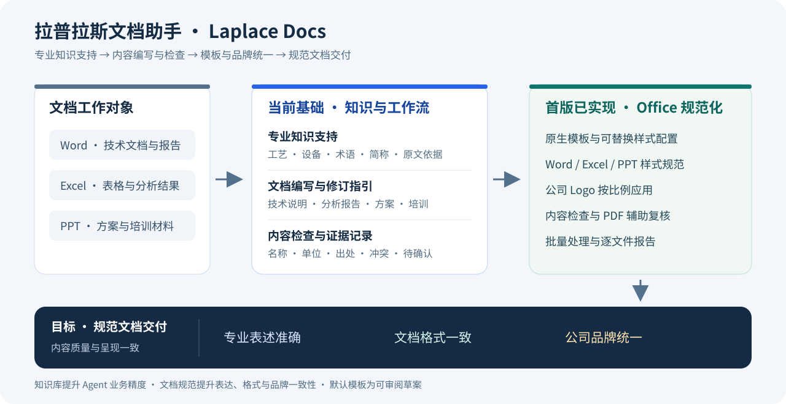
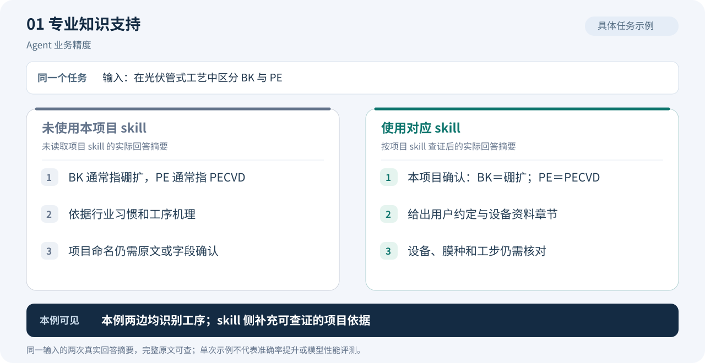
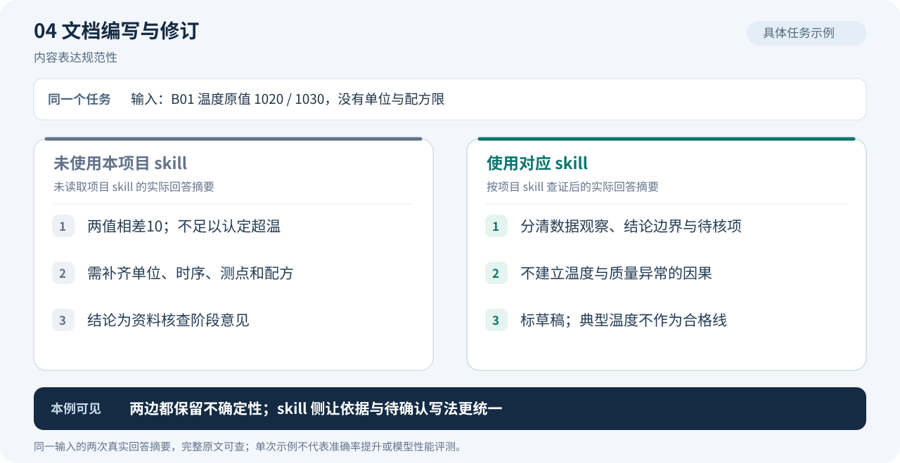
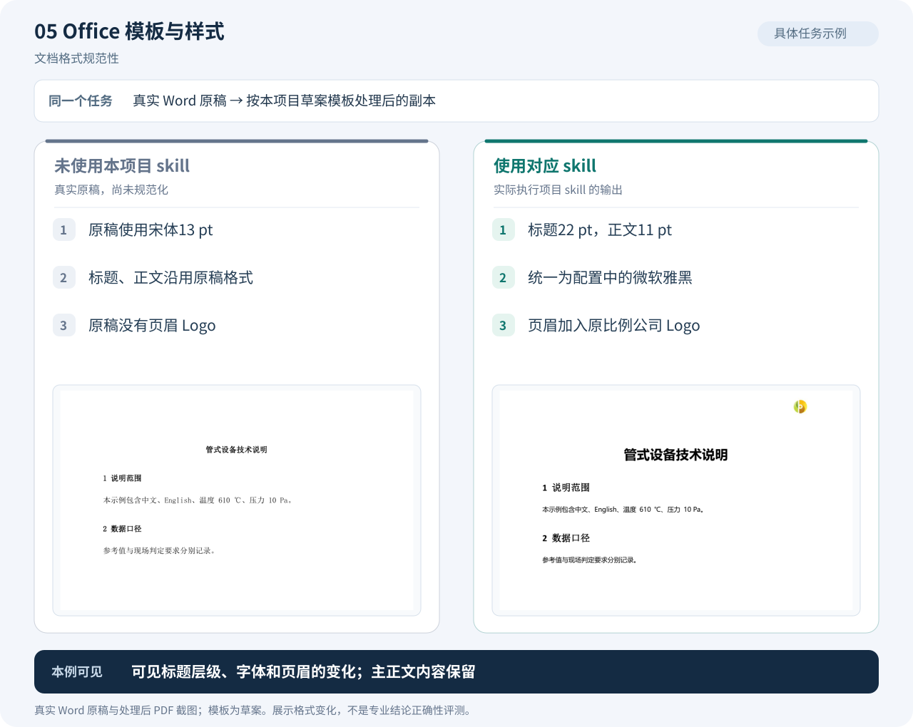
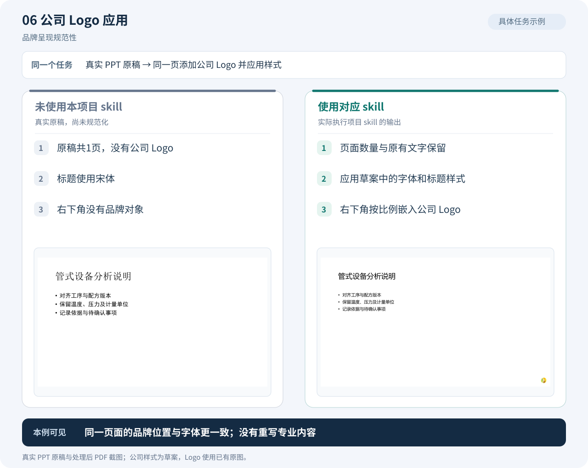
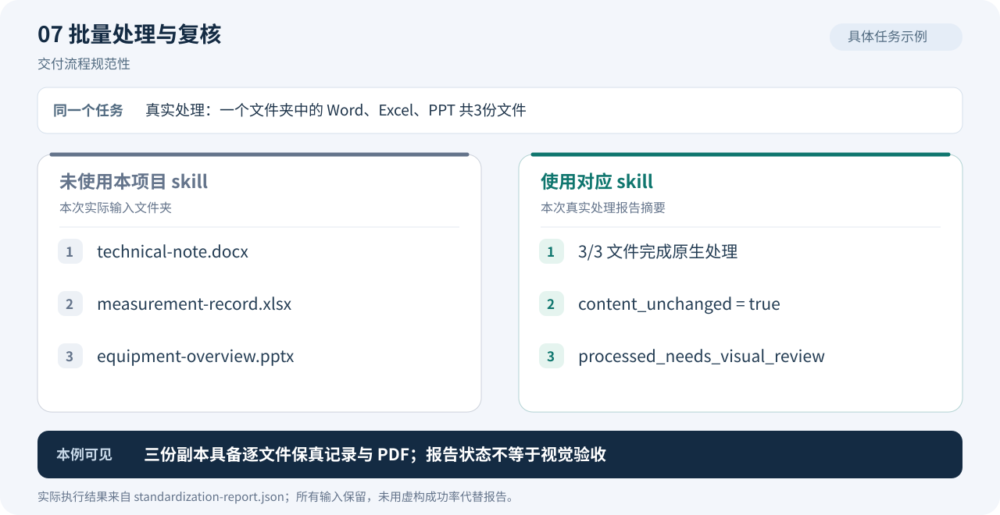
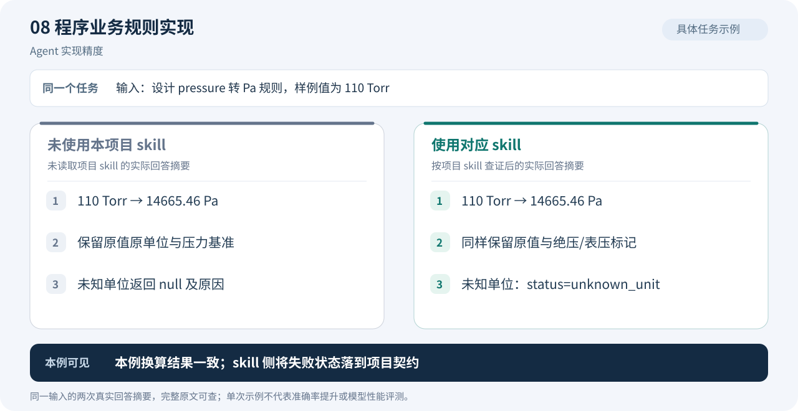
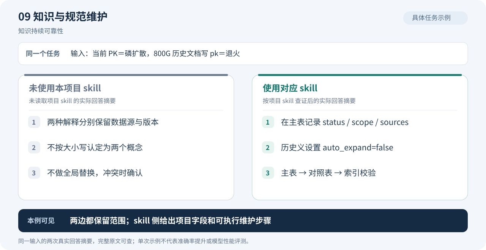
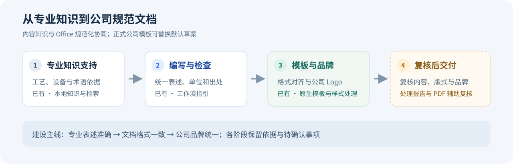

# 拉普老师傅

<p align="center">
  
</p>

**拉普拉斯 Agent 专业知识与自动化技能包**

> 懂业务，干实活，帮你处理琐碎工作。

拉普老师傅为 Agent 提供拉普拉斯业务相关的专业知识、工作方法和执行工具。处理数据、文档或程序时，Agent 可以先查工艺背景、术语和适用口径，再按相应 skill 完成任务，让专业判断有依据，让重复工作少一些。

当前以光伏工艺与管式设备为专业起点，包含 **6 个 skills、可追溯的本地知识库，以及 Word / Excel / PPT 批量规范化工具**。知识库主要增强 Agent 的业务理解与判断精度；工作技能辅助资料查询、数据检查、文档编写和程序开发；Office 工具承担模板、样式与 Logo 等重复操作。



> 从这里开始：[知识库导航](source/README.md) · [Agent 项目入口](AGENTS.md) · [原始资料目录](source/references/kd/00_index.md)

## 1. 能帮你做什么

“老师傅”的价值是懂业务、熟悉工作细节，也能动手处理任务。遇到缺少依据或无法判断的缩写，会把需要确认的问题说明白。

| 工作中遇到的问题 | 拉普老师傅提供的支持 | 预期改善 |
|---|---|---|
| 技术文档中的术语、简称和专业表述不一致 | 专业知识库、名称对照与上下文解释 | 统一内容表达，减少概念混淆 |
| 报告里的参数、单位或结论缺少依据 | 工艺背景、原始章节、数据口径与冲突记录 | 让重要结论有出处、有条件、有适用范围 |
| 编写或修订文档时重复查找业务资料 | 可检索知识与文档工作流 | 复用积累的知识，形成可审阅的内容 |
| Word、Excel、PPT 的样式各不相同 | 已有原生模板与样式处理脚本，正式公司规则可替换配置 | 统一样式，并将复杂版式列为复核项 |
| 公司 Logo 使用不统一 | 已有原图按比例嵌入与重复处理替换规则 | 在 Word 页眉、Excel 工作表/打印页眉、PPT 页面应用 Logo |
| 数据字段、单位和统计对象需要反复核对 | 数据分析 skill 结合知识库检查粒度、单位、缺失项和指标口径 | 减少混算和误解，明确哪些结论还缺依据 |
| 编写数据处理程序时需要反复解释业务规则 | 程序开发 skill 将已确认规则整理为输入输出约定和验证条件 | 让程序实现贴近实际业务 |
| 多份文件需要逐一改格式、加 Logo、整理检查记录 | Office 工具按配置批量处理副本并生成逐文件报告 | 减少重复操作，便于集中复核 |

**专业性看判断是否有依据，自动化看重复操作是否减少，文档规范性看输出是否符合约定。** 当前数据、文档与程序能力由 Agent 按 skill 执行；已有独立批量脚本的是 Office 规范化。实际节省时间与质量改善需通过试点记录验证。

### 可以直接这样交代任务

| 任务 | 对 Agent 说 |
|---|---|
| 查专业知识 | “查一下这份材料里的 BK、PE、PK，结合来源解释，拿不准的先问我。” |
| 检查数据 | “检查这份批次数据的字段、单位和统计口径，列出异常与待确认项。” |
| 写技术文档 | “参考知识库整理这份设备说明，统一术语，给重要结论补上出处。” |
| 处理琐碎格式 | “把这个文件夹的 Word、Excel、PPT 按选定模板统一格式、加 Logo，另存副本并生成检查报告。” |
| 辅助写程序 | “按这份已确认的字段说明编写清洗程序，保留原始值并标记未知单位。” |

首次使用见[快速使用](#7-快速使用)。

## 2. 功能对比：使用与不使用 skill 的实际示例

每个功能一张图。知识类图示摘录了**相同输入下的两次真实回答**：一侧未读取本项目 skill 和业务资料，另一侧按对应 skill 查阅本地依据。Office 类图示使用**本次实际生成并处理的 Word、Excel、PPT 示例文件**，左侧是未规范化原稿，右侧是工具输出。

这些是单次案例，**不是严格的模型 A/B 性能评测，也没有准确率提升的统计结论**。未使用 skill 的回答也可能正确；以下保留两侧结论一致的情况。Office 模板仍为草案，专业内容判断与格式规范化分别检查。

| 改善方向 | 对应功能 | 具体看什么 |
|---|---|---|
| Agent 精度 | 专业知识、简称消歧、数据口径、程序业务规则、知识维护 | 含义是否匹配上下文，条件是否完整，判断是否有项目依据 |
| 文档规范性 | 文档编写、Office 样式、公司 Logo、批量处理与复核 | 术语与结论写法是否一致，样式是否符合所选模板，交付记录是否完整 |
| 琐碎工作自动化 | 模板应用、Logo 放置、批量处理与报告生成 | 哪些步骤已由工具完成，哪些仍需人工确认和复核 |

### 2.1 专业知识支持：从行业解释到项目依据

**实际问题：**“在光伏管式工艺中，用两句话区分 BK 与 PE，并说明依据和不确定项。”两侧都识别了硼扩和 PECVD；使用 skill 的回答进一步引用本项目用户命名约定及设备资料章节，明确仍需核对设备、膜层和工步。



[完整输入、原始回答与出处](docs/examples/agent-comparison.md#knowledge) · [kd-context](skills/kd-context/SKILL.md)

### 2.2 简称与上下文消歧：从可能含义到有依据的解释

**实际问题：**Longji OD 数据有 `TubeID/BoatID/ZoneID/P1–P5/Homogen/Quality`，OD 指什么，ZoneID 是温区吗？未读本地资料的回答保留多种可能；使用 skill 后，能根据资料说明 OD 是方阻检测数据，ZoneID 是检测位置，不能直接等同加热温区。


[完整输入、原始回答与出处](docs/examples/agent-comparison.md#names) · [名称消歧流程](source/workflows/name-disambiguation.md)

### 2.3 数据口径核对：明确哪些指标还不能计算

**实际输入：**同一炉管和批次在 `08:00/08:30` 的两条记录，`count` 从 0 增至 500，温度原值从 610 升至 615。两侧均未臆算 OEE；使用 skill 的回答进一步明确，记录间隔不等于整批周期，计数变化也不能直接当作良品产量。


[完整输入、原始回答与出处](docs/examples/agent-comparison.md#data) · [kd-data-analysis](skills/kd-data-analysis/SKILL.md)

### 2.4 文档编写：统一观察、结论边界与待确认事项

**实际任务：**为批次 B01 撰写报告开头，只有温度原值 1020/1030，没有单位和配方限。两侧都没有认定超温；使用 skill 的草稿把数据观察、因果边界和待核事项分别写清，并指出典型工艺温度不能当作本批次合格线。



[完整输入、原始回答与出处](docs/examples/agent-comparison.md#document) · [kd-document-writing](skills/kd-document-writing/SKILL.md)

### 2.5 Office 模板与样式：查看真实 Word 前后变化

**实际文件：**`technical-note.docx`。原稿使用宋体 13 pt；工具按草案配置统一为微软雅黑，并设置标题 22 pt、正文 11 pt、页眉 Logo。下图直接嵌入原生 PDF 的页面截图，正文内容保真检查通过。



[原稿 PDF](docs/examples/office/before/technical-note.before.pdf) · [处理后 PDF](docs/examples/office/after/technical-note.review.pdf) · [处理后 Word](docs/examples/office/after/technical-note.docx)

### 2.6 公司 Logo：查看真实 PPT 的品牌呈现变化

**实际文件：**同一页 `equipment-overview.pptx`。处理前无 Logo，处理后在右下角按原比例放置公司 Logo，同时应用草案字体和标题样式，页面数量与原有文字保留。截图展示实际输出，不代表正式公司模板已获批准。



[原稿 PDF](docs/examples/office/before/equipment-overview.before.pdf) · [处理后 PDF](docs/examples/office/after/equipment-overview.review.pdf) · [处理后 PPT](docs/examples/office/after/equipment-overview.pptx)

### 2.7 批量处理与复核：从文件夹到逐文件交付记录

**实际执行：**对示例文件夹的 Word、Excel、PPT 共 3 份文件运行 `laplace-office-standardize`。报告记录 3 份文件均完成原生处理，`content_unchanged=true`；原始状态为 `processed_needs_visual_review`，不会将程序检查等同于视觉验收。本次另行渲染并查看了三份输出 PDF 的首页。



[本次真实处理报告](docs/examples/office/after/standardization-report.json) · [处理前文件夹](docs/examples/office/before/) · [处理后文件夹](docs/examples/office/after/)

Excel 也包含在这次处理内：[原稿 PDF](docs/examples/office/before/measurement-record.before.pdf) · [处理后 PDF](docs/examples/office/after/measurement-record.review.pdf) · [处理后 Excel](docs/examples/office/after/measurement-record.xlsx)。表头样式与打印页眉 Logo 已改变，数值、公式、数字格式及工作表结构保留。

### 2.8 程序业务规则：将正确计算衔接到项目契约

**实际任务：**设计 `pressure` 转 Pa 的输入输出规则，并计算 110 Torr。两侧都得到约 `14665.46 Pa`，都保留原值与压力基准；使用 skill 的回答进一步采用明确的 `status=unknown_unit` 等契约写法。



[完整输入、原始回答与出处](docs/examples/agent-comparison.md#software) · [kd-software-development](skills/kd-software-development/SKILL.md)

### 2.9 知识与规范维护：把范围约定落到主表和校验步骤

**实际任务：**当前 PK 表示磷扩散，800G 历史文档却将 pk 标为退火。两侧都保留局部解释而不全局替换；使用 skill 的回答进一步明确主表字段 `status/scope/sources`、历史义的 `auto_expand=false` 及对照表、索引的同步步骤。



[完整输入、原始回答与出处](docs/examples/agent-comparison.md#maintenance) · [kd-knowledge-maintenance](skills/kd-knowledge-maintenance/SKILL.md)

图中回答为摘要，完整原文保存在[实际回答示例](docs/examples/agent-comparison.md)；图中文字及素材引用维护在 [comparison-scenarios.json](docs/comparison-scenarios.json)，可运行 `python docs/tools/build_comparisons.py` 重新生成，`--check` 检查一致性。

## 3. 从专业知识到规范文档



以“整理一份设备技术说明”为例，目标工作过程为：

1. **理解文档用途**：识别读者、文档类型、产品或设备范围及交付要求。
2. **补足专业依据**：检索相关工艺、设备、术语和原始章节。
3. **编写与内容检查**：统一术语、简称、单位和表述，记录依据与待确认事项。
4. **应用模板与 Logo**：使用 `laplace-office-standardize` 处理副本，统一样式并按配置应用公司 Logo。
5. **复核与交付**：检查内容保真报告及输出/PDF中的版式，形成待复核项后交付。

现有工具已支持这一流程的基础能力。专业内容检查由知识库与 Agent 工作流支撑；Office 工具负责模板、样式、Logo 和程序保真检查，复杂版式仍需实际复核。

## 4. 六个 skills，各自负责什么

拉普老师傅是这套技能的统一名称。Agent 根据任务读取相应 skill，再按需查询知识或调用工具；当前路由入口见 [AGENTS.md](AGENTS.md)。

| 当前 skill | 职责 | 主要产出 |
|---|---|---|
| [kd-context](skills/kd-context/SKILL.md) | 专业知识查询与名称消歧 | 带出处和适用范围的解释、需要确认的问题 |
| [kd-data-analysis](skills/kd-data-analysis/SKILL.md) | 数据检查与分析 | 字段、单位、粒度和指标口径检查，分析结果与限制 |
| [kd-document-writing](skills/kd-document-writing/SKILL.md) | 文档编写、修订与内容检查 | 技术说明、报告草稿、修改摘要与待确认事项 |
| [kd-software-development](skills/kd-software-development/SKILL.md) | 业务相关程序开发与审查 | 数据契约、程序实现建议或修改、验证依据 |
| [kd-knowledge-maintenance](skills/kd-knowledge-maintenance/SKILL.md) | 知识和术语维护 | 有来源与范围的知识更新、同步后的对照表和索引 |
| [laplace-office-standardize](skills/laplace-office-standardize/SKILL.md) | Office 格式与品牌规范化 | 规范化副本、逐文件保真报告、可选 PDF 复核材料 |

知识库提供专业依据，skills 规定处理任务的方法，脚本执行可重复的操作。例如整理一份分析报告，可以组合数据分析、文档编写和 Office 规范化三个技能。

技能实体保存在 `skills/`，`.agents/skills/` 中的目录联接连接到这些实体目录。

## 5. Office 标准化的当前范围

首版工具支持 Windows 上已安装的 Microsoft Word、Excel 和 PowerPoint，处理 `.docx/.xlsx/.pptx` 并另存副本。当前 [样式配置](skills/laplace-office-standardize/assets/company-profile.json) 和原生模板均为**可审阅草案**，Logo 使用用户提供的原图。正式模板提供后可通过新配置版本替换。

| 文档类型 | 当前处理内容 | 处理时保留的内容 |
|---|---|---|
| Word | 复制模板样式、按现有语义样式统一字体/字号、页边距、页眉 Logo | 主正文、直接强调、原有图片与其他页眉内容 |
| Excel | 正文字体、指定表头行、行列适配、工作表空白区 Logo 和打印页眉 Logo | 数值、公式、数字格式、单元格位置与工作表结构 |
| PowerPoint / PPT | 应用设计模板、字体与占位符字号、逐页 Logo | 页面数量、原画布、文本和原有对象；复杂版式逐页复核 |

模板应按文档用途记录版本和适用范围，例如技术说明、分析报告、客户方案、培训资料。Logo 应用规则需规定素材版本、放置位置、比例、留白以及哪些页面使用；具体要求以纳入项目的公司规范为准。

每批输出 `standardization-report.json`，记录逐文件结果、配置版本、输入/输出哈希、内容检查与复核提示。可用 `--pdf` 输出原生 Office 复核副本。当前不把任意 Excel 表格重排成另一套单元格布局，也不自动重排 PPT 自由布局；详见 [格式与保真约定](skills/laplace-office-standardize/references/format-contract.md)。

模板草案预览：[Word](skills/laplace-office-standardize/assets/templates/word.pdf) · [Excel](skills/laplace-office-standardize/assets/templates/excel.pdf) · [PPT](skills/laplace-office-standardize/assets/templates/powerpoint.pdf)。

## 6. 专业知识库如何提升 Agent 精度

| 主题 | 内容 | 入口 |
|---|---|---|
| 工艺路线 | 硅材料、硅片、电池、组件；PERC、TOPCon、HJT 等路线的区别 | [工艺地图](source/knowledge/process-map.md) |
| 管式设备 | 硼扩散、氧化、LPCVD、PECVD；炉管、舟、温区和工步 | [设备知识](source/knowledge/equipment.md) |
| 测试与质量 | I-V、EL、PL、寿命、效率及相关材料 | [质量与材料](source/knowledge/quality-and-materials.md) |
| 名称与简称 | 英文全称、中文名、别名、用途和出处 | [术语主表](source/glossary.json) |
| 资料差异 | 单位、参数、工艺顺序等冲突及现场信息缺口 | [缺口与冲突](source/knowledge/gaps-and-conflicts.md) |
| 文档工作方法 | 编写、内容检查、依据记录与交付建议 | [文档工作流](source/workflows/document-writing.md) |

当前知识以光伏工艺与设备为起点，覆盖 TOPCon、PERC、HJT，以及管式扩散、氧化、LPCVD 和 PECVD。初始工艺参考来自 `KD\OEE_docs\kd` 的 **16 份 Markdown**，原文以快照形式保存在本项目中。

后续可继续纳入拉普拉斯的产品资料、设备说明、确认后的术语表、文档规范和典型案例。专业知识、公司规定、数据观察和工作建议分别保留来源及适用范围。

### 同一个概念，可以有多个名称

项目采用“概念 → 多个名称”的业务思路，既考虑英文缩写，也考虑中文简称和数据集中的代号。

| 概念 | 名称示例 | 来源与使用约定 |
|---|---|---|
| 硼扩散 | 硼扩、BK | 用户给出的业务约定 |
| PECVD | PE | 用户给出的业务约定；结合沉积工序语境解释 |
| 磷扩散 | PK | 用户给出的业务约定；读取具体数据集时核对字段说明 |

以上示例已接入名称查询，**具体条目与适用范围以 [glossary.json](source/glossary.json) 为准**。`PK`、`OD` 等名称可能存在多义，需按[名称消歧流程](source/workflows/name-disambiguation.md)核对上下文，仍不能判断时向用户确认。数据集代号保留厂区、设备、字段或文件范围；仅凭字母或拼音不能确认含义。

## 7. 快速使用

### 接入 Agent 工作区

在项目根目录打开 Agent 会话，让它先读取 [AGENTS.md](AGENTS.md)。Windows 下可运行以下命令建立本机技能发现入口：

```powershell
& .\source\tools\connect-skills.ps1
```

技能实体位于 `skills/`，`.agents/skills/` 是本机生成的目录联接，不随 Git 提交。没有自动发现时，可直接指定对应 `SKILL.md`。知识查询依赖本地 Python；Office 批量规范化还需要 Windows 和已安装的 Microsoft Office。

### 当前可用：基于知识库编写与修订文档

在本工作区工作时，可先让 Agent 读取 [AGENTS.md](AGENTS.md)，再提出具体要求：

```text
参考本项目知识库，修订这份拉普拉斯设备技术说明。
统一专业术语、中文简称、英文缩写和计量单位，
检查重要参数与结论的依据，列出冲突及待确认事项。
沿用已有文档风格，并提供修改摘要。
```

也可以直接指定技能文件：

```text
使用 skills/kd-document-writing/SKILL.md，
为这份设备分析材料写一份技术说明，沿用原有术语与文档风格。
```

### 当前可用：模板、样式与公司 Logo 规范化

可以直接指定新技能与输入文件夹：

```text
使用 laplace-office-standardize，处理这个文件夹中的 Word、Excel、PPT。
按选定模板与样式配置统一格式，应用公司 Logo，保留原文件，
输出到新目录，并检查内容保真报告和 PDF 复核副本。
```

```powershell
# 检查本机 Office、配置、Logo 与模板；不启动 Office
python skills/laplace-office-standardize/scripts/office.py doctor

# 先查看批量处理计划，再另存规范化副本和 PDF
python skills/laplace-office-standardize/scripts/office.py apply "输入文件夹" --output "新的输出目录" --recursive --dry-run
python skills/laplace-office-standardize/scripts/office.py apply "输入文件夹" --output "新的输出目录" --recursive --pdf
```

旧版 `.doc/.xls/.ppt` 先转换为现代格式；加密、受保护、含宏/数字签名及外部数据连接文件使用专门保真流程。公司正式模板尚未提供时，处理报告保留 `approval_status=draft`。

### 使用本地命令查询

检索工具需要 **Python 3.10 或以上版本**，核心工具仅使用标准库，无需模型 API 或向量数据库。以下命令在项目根目录运行：

```powershell
# 定位相关知识与原文段落
python source/tools/kb.py search "硼扩散 炉管" --limit 5

# 查询英文缩写的全称、中文含义、用途和出处
python source/tools/kb.py abbr "LPCVD"

# 按类别查看，或输出供程序使用的 JSON
python source/tools/kb.py abbr --category testing --limit 10
python source/tools/kb.py abbr "PECVD" --json

# 查看实际可用的命令与选项
python source/tools/kb.py --help
```

`search` 返回文件、章节、行号和摘录；命中内容是定位线索，引用关键结论前仍应阅读原文上下文。索引缺失或过期时，可先用 `rg -n "关键词" source` 查找资料。

如果本机 `python` 指向 Windows 应用执行别名，可使用实际安装的 Python；本机已知解释器的调用示例见 [知识库使用说明](source/README.md)。

## 8. 当前目录与职责

```text
KD/
├─ README.md                    拉普老师傅定位、实际案例与使用说明
├─ AGENTS.md                    Agent 的项目工作约定与技能路由
├─ skills/                      当前六个技能的实体目录
│  ├─ kd-context/
│  ├─ kd-data-analysis/
│  ├─ kd-document-writing/
│  ├─ kd-software-development/
│  ├─ kd-knowledge-maintenance/
│  └─ laplace-office-standardize/ 模板、Logo、批量处理脚本与保真约定
├─ .agents/skills/               指向 skills/ 的本地目录联接
├─ source/
│  ├─ README.md                 知识库详细导航与维护说明
│  ├─ references/kd/            原始工艺资料快照
│  ├─ knowledge/                工艺、设备、质量及冲突整理
│  ├─ evidence/                 数据集研究的证据摘录
│  ├─ workflows/                数据、文档和程序的工作建议
│  ├─ templates/                数据契约、报告和变更检查模板
│  ├─ glossary.json             术语与名称主表
│  ├─ catalog.json              文件、章节与哈希索引
│  ├─ manifest.json             原文来源与快照哈希清单
│  ├─ tools/                    本地检索、索引与校验工具
│  └─ tests/                    工具行为验证
└─ docs/
   ├─ images/                   总览、流程与九张功能对比图
   ├─ examples/                 实际回答、Office原稿/输出、PDF与截图
   ├─ comparison-scenarios.json  功能图文与素材引用
   └─ tools/                    对比图生成与示例导出工具
```

| 需要准备的工作材料 | 可复用模板 |
|---|---|
| 文档中数据的含义、对象关系、时间与指标口径 | [数据契约](source/templates/data-contract.yaml) |
| 分析输入、处理规则、结果和证据 | [分析报告](source/templates/analysis-report.md) |
| 文档读者、用途、范围和交付要求 | [文档简报](source/templates/document-brief.md) |
| 支撑程序变更的业务边界与验证依据 | [变更检查](source/templates/change-checklist.md) |

## 9. 建设路线与维护

后续围绕“专业判断更贴近业务、重复工作更省事”推进。以下为建议路线，试点部门、首批任务与验收目标待结合实际使用需求确定。

| 下一步 | 具体工作 | 如何判断有效 |
|---|---|---|
| 补齐适用知识 | 接入现场确认的术语、字段说明、产品资料和正式模板 | 关键解释可追溯，版本与适用范围清楚 |
| 验证高频任务 | 选择一个使用团队，围绕真实任务验证查询、编写、检查和格式处理 | 记录达到同等交付质量所需的总人工时间与返工次数 |
| 扩展重复操作 | 将试点中稳定、反复出现的处理步骤沉淀为脚本与 skills | 可重复执行，有输入输出记录和检查结果 |

专业性评估关注业务含义是否正确、重要结论是否有依据；文档规范性评估关注模板与规则符合程度。效率评估包含提问、核对和修改输出的人工时间，现有对比案例不代表已取得统计意义上的准确率或工时收益。

### 当前建设基础

| 阶段 | 建设重点 | 状态 |
|---|---|---|
| 专业知识基础 | 工艺资料、术语、来源、冲突记录与本地检索 | 当前已有 |
| 文档内容规范 | 依托现有工作流编写、修订与检查；逐步形成公司规则和独立检查能力 | 已有基础，继续完善 |
| 公司模板与品牌资料 | 已保存用户提供的 Logo，随附 DOTX/XLTX/POTX 草案；继续接入正式公司模板 | 已有草案，待正式规范 |
| Office 标准化处理 | 原生模板接口、样式规范化、Logo、内容检查与复核副本 | 首版已实现 |
| 批量处理与交付检查 | 单文件/文件夹递归处理、另存副本、逐文件报告 | 首版已实现，复杂布局继续完善 |

新增知识时，先明确它属于原始资料、现场确认规则、数据观察还是工作建议，再放入对应位置。术语与名称从主表维护，重要条目附来源、版本、适用范围和确认状态。

常用的只读检查：

```powershell
python source/tools/kb.py index --check
python source/tools/kb.py verify
python -B -m unittest discover -s source/tests -v
```

修改可检索知识后，通过维护工作流更新索引；需要刷新原文时，再审阅差异并更新快照。[manifest.json](source/manifest.json) 与 [catalog.json](source/catalog.json) 各有职责：前者记录原始快照依据，后者记录当前可检索文件；重建索引不会重新签署原文哈希。

更多维护步骤与当前工具说明见 [知识库入口](source/README.md) 和 [维护技能](skills/kd-knowledge-maintenance/SKILL.md)。

### 内容与规范的维护原则

- **典型工艺值保留参考性质。** 文献温度、压力和周期不直接成为现场报警限、正式配方或判废线。
- **指标保留计算条件。** 光伏转换效率与设备 OEE 分别解释；OEE 需明确状态映射、计划时间、理想节拍和质量计数规则。
- **结论保留证据层次。** 原文事实、数据观察、分析推断、建议和待确认事项有清晰标记；相关性不能直接证明根因。
- **现场定义保留版本。** 已确认且适用的现场文件用于解释具体任务；与旧资料不同的地方记录差异和范围。
- **校验结果保留能力范围。** 文件哈希、索引和链接检查证明本地资料完整性，技术事实与生产适用性仍需相应证据。

公司模板、品牌素材和文档规则纳入后，同样记录版本、适用范围及确认状态。专业内容检查与格式检查共同服务于规范文档交付。
