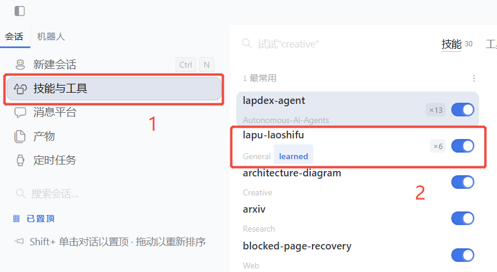

# 拉可老师傅

<p align="center">
  
</p>

**让 AI 听懂你的行话，查资料有依据，交文件更省事。**

面向拉普拉斯光伏业务，为 **Lapdex** 配备专业知识、内部术语和工作方法。安装“拉可老师傅”技能包后，在对话里查清概念、审阅技术材料、编写报告、批量统一 Office 格式。

- **懂黑话**：从业务资料和工作交流中理解网上查不到的内部用语，经确认持续积累，越用越懂你的工作语言。
- **懂专业**：内置光伏知识库，结合工艺、设备与数据背景查资料、做分析，让判断与产出更贴近实际业务。
- **爱学习**：经你确认，将工作约定、个人偏好与私有知识沉淀为专属记忆，越用越懂你，越用越顺手。
- **办杂事**：文档调格式、套模板、加 Logo、批量处理等琐碎工作，按既定规范自动处理，让你少做重复活。

**当前发行：Lapdex 技能包 v0.2.3，提供一个入口、六类业务工作流，支持“爱学习”本机私有记忆，并提供 Windows 一键安装脚本。** [查看版本范围](docs/usage.md#version)

**[下载技能包](dist/laco-laoshifu-lapdex-0.2.3.zip) · [立即试用](#quick-start) · [看真实效果](#results) · [Lapdex 用户手册](docs/usage.md)**

<a id="quick-start"></a>

## 在 Lapdex 中开始

选择下面任一种方式安装。

### 1. 在 Lapdex 对话中从 GitHub 安装 ⭐ 最推荐

直接在 Lapdex 对话里输入：

```text
从 https://github.com/lplsaiorg/laco_laoshifu 拉取最新的release进行安装
```

需要当前会话可访问 GitHub、下载文件并执行安装操作。若没有可用的 Release，继续让 Lapdex 按仓库 README 下载 `dist/` 中的当前发行 ZIP 安装。

### 2. Windows 一键安装

下载并完整解压[当前技能包](dist/laco-laoshifu-lapdex-0.2.3.zip)，双击解压目录中的 `laco-laoshifu/install.bat`。需要已配置可用的 Lapdex CLI，且在终端中能运行 `lapdex`。脚本会把解压目录作为安装路径交给 CLI，查看终端中的实际安装结果。

### 3. 在 Lapdex 对话中安装本地技能包

下载并完整解压[当前技能包](dist/laco-laoshifu-lapdex-0.2.3.zip)，将下面占位内容替换为解压后 `laco-laoshifu` 文件夹的实际绝对路径，再在 Lapdex 对话里输入：

```text
安装路径“<解压后的 laco-laoshifu 文件夹绝对路径>”下的 skill
```

### 4. 手动复制安装

下载[当前技能包](dist/laco-laoshifu-lapdex-0.2.3.zip)，将包内完整的 `laco-laoshifu` 文件夹解压到 `%USERPROFILE%\.lapdex\skills\`。使用自定义技能目录或其他 profile 时，以当前 Lapdex 配置为准。确保安装目录内同时包含 `SKILL.md` 和 `references/`。

### 5. 使用源码中的 Python 安装器

获取本仓库源码，在仓库根目录用 Python 3.10+ 执行：

```powershell
python scripts/package_lapdex.py --check dist/laco-laoshifu-lapdex-0.2.3.zip
python scripts/package_lapdex.py --install dist/laco-laoshifu-lapdex-0.2.3.zip --dry-run
python scripts/package_lapdex.py --install dist/laco-laoshifu-lapdex-0.2.3.zip
```

自定义技能目录时，在安装命令后添加 `--skills-dir "<当前 Lapdex 技能目录的绝对路径>"`。安装器会校验归档，目标目录已存在时拒绝覆盖。

### 安装后启用

等待技能列表刷新，必要时重新打开 Lapdex，再按图中编号操作。

1. 点击左侧的 **“技能与工具”**。
2. 在“技能”列表中找到 **`laco-laoshifu`（拉可老师傅）**，打开该行右侧的开关。**蓝色且圆点在右侧**表示已启用。



*截图来自虚拟机中的旧版安装，技能名显示为 `lapu-laoshifu`；当前版本请查找 `laco-laoshifu`，点击位置见图中编号。*

已有同名安装时，先按[升级与备份](docs/usage.md#upgrade)处理。

在 Lapdex 对话中先试一句：“用拉可老师傅查询硼扩散有哪些简称，说明出处和适用范围。”

接着给出工作文件的绝对路径。下面是示例，请替换为自己电脑上的实际路径：

```text
用拉可老师傅审阅“用户选定的材料（设备说明.docx）”。
统一术语和单位，检查关键参数与结论的依据，
保留需要确认的地方，给我修订稿和修改摘要。
输出到“用户选定的材料（老师傅输出）”，保留原文件。
```

你可以先检查内容，再追加“按选定模板统一格式、加 Logo，另存副本”。日常材料留在自己的工作目录中，Lapdex 从安装目录读取知识与工具。内容编写与审阅由助手按工作流完成，Office 工具负责样式与批量处理，输出经复核后交付。

也可以从这些小任务试起：

| 你手头的工作 | 直接这样说 | 可以得到什么 |
|---|---|---|
| 看不懂资料或数据里的简称 | “用拉可老师傅解释‘用户选定的材料（字段说明.md）’里的 BK、PE、OD，结合来源判断，拿不准的列出来。” | 名称解释、适用范围、出处与待确认项 |
| 一批文档需要整理格式 | “用拉可老师傅规范化‘用户选定的材料（待处理）’，按选定模板统一格式、加 Logo，输出到‘用户选定的材料（规范化输出）’，保留原件。” | 规范化文件、逐文件处理与检查报告 |
| 数据口径需要核对 | “用拉可老师傅检查‘用户选定的材料（批次数据.csv）’的字段、单位、粒度和缺失项，列出可分析内容与待确认口径。” | 数据检查结果、分析边界与依据 |

**运行条件：**需已有 Lapdex，当前会话可读取技能与工作文件。直接阅读随包资料可先体验；运行检索脚本需要 Python 3.10+，Office 批量处理另需 Windows、PowerShell 和对应的 Microsoft Office 桌面应用。详细步骤见[安装与启用](docs/usage.md#install)。

<a id="results"></a>

## 先看两件已经做过的事

以下来自已有知识与工具的实际案例：知识类展示同一输入下的两次回答，Office 类展示实际处理的文件。它们可供检查效果，尚无统计意义上的准确率或节省工时结论；所用 Office 模板为草案。这些案例不是 Lapdex 实机调用记录，当前适配的验证范围见[用户手册](docs/usage.md#version)。

### 看懂数据里的行话，避免把检测位置当成温区

**实际问题：**Longji OD 数据中的 `ZoneID` 是加热温区吗？

查阅项目资料后，助手将这个来源中的 OD 解释为方阻检测数据，并指出 `ZoneID` 对应硅片检测位置，不能直接等同于炉管加热温区。这个解释保留来源范围，后续分析可以据此核对对象关系。


[查看完整输入、两次回答和出处](docs/examples/agent-comparison.md#names)

### 把已有 Word 整理成统一样式，保留正文内容

**实际文件：**`technical-note.docx`。工具按草案配置统一标题、正文字体和页眉 Logo；主正文内容检查通过，输出了可编辑副本及 PDF 复核材料。


[原稿 PDF](docs/examples/office/before/technical-note.before.pdf) · [处理后 PDF](docs/examples/office/after/technical-note.review.pdf) · [处理后 Word](docs/examples/office/after/technical-note.docx)

同一批次还处理了 Excel 和 PPT，共 3 份示例文件，均有逐文件检查记录。程序检查与视觉复核分别记录，复杂版式仍需实际查看。

**[查看全部九组案例](docs/examples/README.md)**：专业知识、简称消歧、数据口径、文档编写、Word 样式、PPT Logo、批量处理、程序规则、知识维护。原始回答、文件和出处均保留。

<a id="workflow"></a>

## 从材料到交付，怎样配合你工作

以整理一份设备技术说明为例，现有知识、工作流和工具可以组合成下面的处理过程：

1. **明确用途。** 结合材料确认读者、设备或工序范围、文档要求。
2. **查清依据。** 检索术语与专业资料，核对来源、单位和适用条件。
3. **编写与修订。** 沿用原有风格，给出修改摘要，保留冲突与待确认项。
4. **整理格式。** 对文档副本应用选定模板、样式与 Logo。
5. **复核交付。** 核对业务内容、处理报告和实际版式，再采用输出。

涉及重要含义不明的术语时，先确认相关解释；其他独立检查可以继续。行业典型参数保留参考性质，现场配方、报警限和质量判定以适用的批准资料为准。

[查看处理流程图](docs/images/task-workflow.svg) · [查看 Office 处理与保真范围](docs/usage.md#office)

<a id="capabilities"></a>

## 哪些工作可以交给它

| 工作方向 | 当前支持 | 你可以继续查看 |
|---|---|---|
| **查知识、懂简称** | 本地知识检索、多名称查询、结合来源消歧，给出依据与适用范围 | [知识与术语入口](source/README.md) |
| **写文档、审材料** | 按业务工作流编写与修订，核对术语、单位、结论依据及待确认事项 | [文档工作流](skills/kd-document-writing/SKILL.md) |
| **看数据、核口径** | 检查字段、单位、粒度和缺失项，辅助分析与说明计算边界 | [数据分析工作流](skills/kd-data-analysis/SKILL.md) |
| **写程序、查规则** | 将已确认的业务规则转为数据契约、实现和验证条件 | [程序工作流](skills/kd-software-development/SKILL.md) |
| **批量处理 Office** | 单文件或文件夹处理、模板样式与 Logo、另存副本、逐文件检查 | [格式与保真约定](skills/laplace-office-standardize/references/format-contract.md) |
| **复用工作约定** | 经授权保存和复用本机私有记忆，按项目或数据源范围读取 | [源码用法](docs/maintenance.md#memory) · [版本范围](docs/usage.md#memory) |
| **积累团队知识** | 用户要求维护时，整理来源、版本和适用范围，更新术语与知识索引 | [知识维护工作流](skills/kd-knowledge-maintenance/SKILL.md) |

Lapdex 通过一个 `laco-laoshifu` 入口，按任务调用六类业务工作流和随包工具。数据、文档与程序任务由助手按工作流执行；Office 已有独立批量脚本。知识以光伏工艺和管式设备为起点，包含 16 份原始工艺参考快照，以及术语、数据集说明和冲突记录。

**使用时需要了解的范围：**

- 当前公司样式及 Word、Excel、PPT 模板是可审阅草案，正式模板可按版本替换。
- Office 工具保留原有结构；任意 Excel 布局转换、PPT 自由布局重排需要另外处理，复杂版式需复核。
- 私有记忆保存在本机用户目录，跨会话复用需要助手加载技能并能访问该目录。
- 当前已有工具与示例；真实岗位的持续使用效果、净节省工时及质量改善仍需试点验证。
- 当前已完成打包、隔离安装和知识库检查；Lapdex 中的实际发现、启用及完整任务调用尚待实机验证。

[了解六类工作流](docs/usage.md#version) · [浏览专业知识范围](docs/maintenance.md#knowledge)

<a id="next"></a>

## 下一步：让真实工作验证价值

建议选择一个使用团队、一类高频任务，验证从资料核对到文档交付的实际效果。重点记录业务同事能否独立使用、输出是否采用，以及达到同等交付质量所需的总人工时间。

计时包括准备、交代任务、核对、修改和失败返工；试点中的稳定处理步骤再沉淀为可复用技能。试点团队、任务和验收目标待结合实际需求确定。

<a id="navigation"></a>

## 按需要继续

| 我想了解 | 从这里进入 |
|---|---|
| 看更多真实效果、检查原始产物 | [全部案例与素材](docs/examples/README.md) |
| 安装、启用、提供文件、检查结果和排障 | [Lapdex 用户手册](docs/usage.md) |
| 找工艺、设备、测试和术语资料 | [知识库导航](source/README.md) |
| 理解源码技能、目录和维护方法 | [源码维护参考](docs/maintenance.md) |
| 查看当前发行包范围和升级方法 | [版本说明](docs/usage.md#version) · [升级与备份](docs/usage.md#upgrade) |
