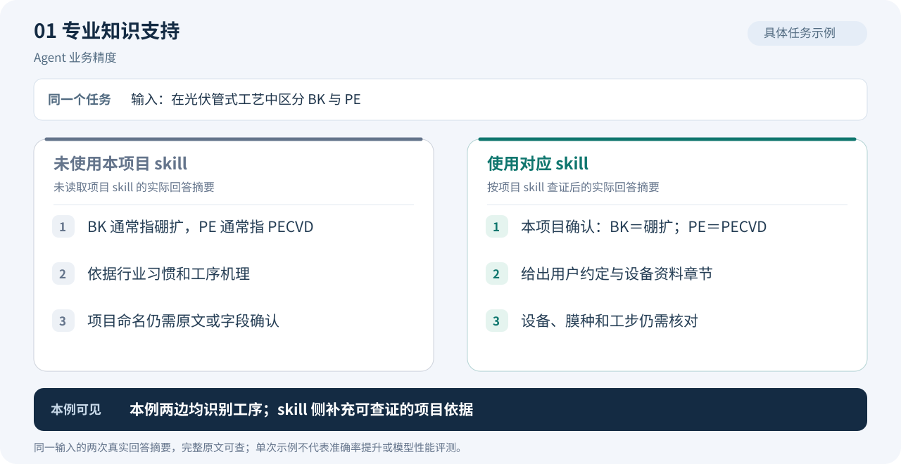
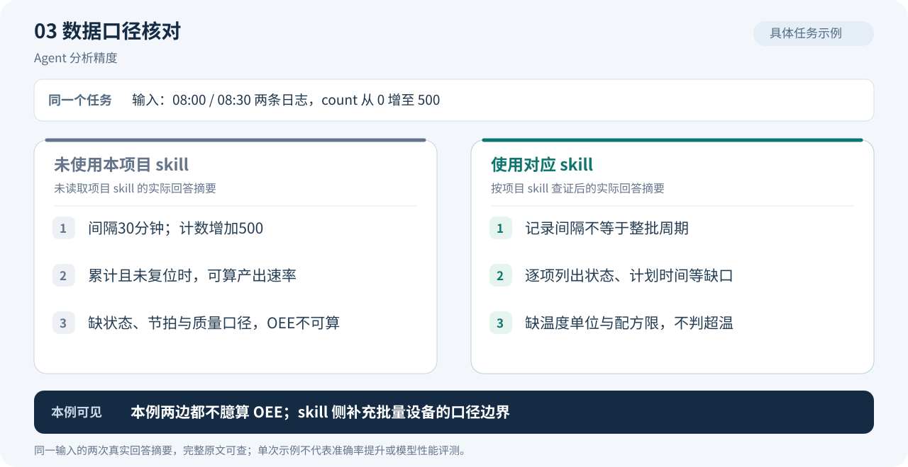
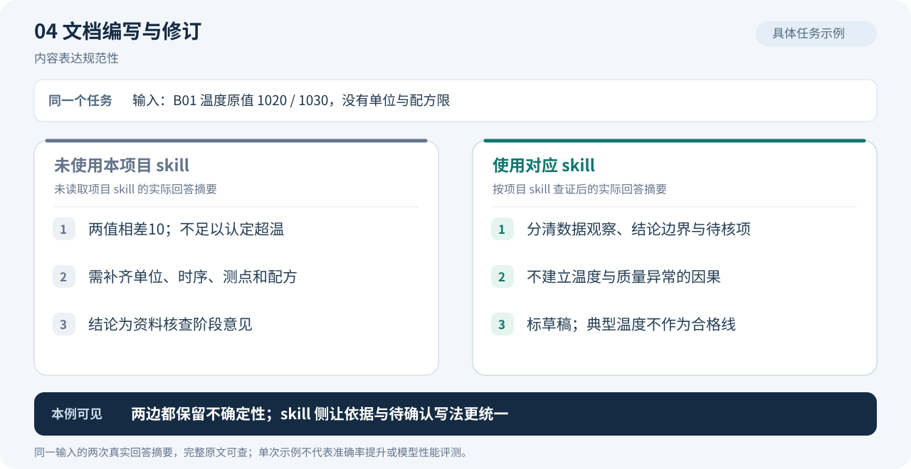
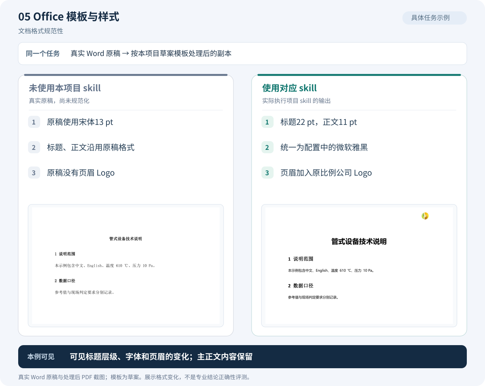
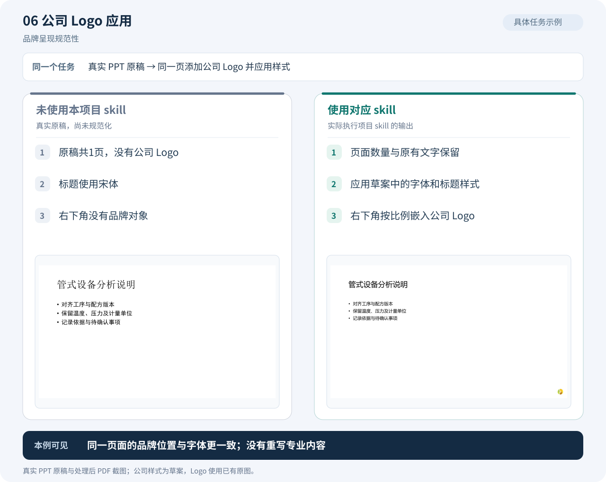
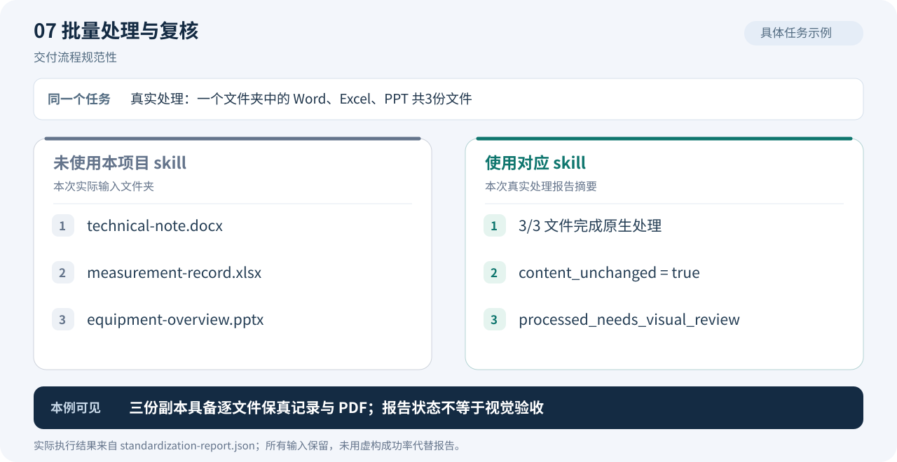
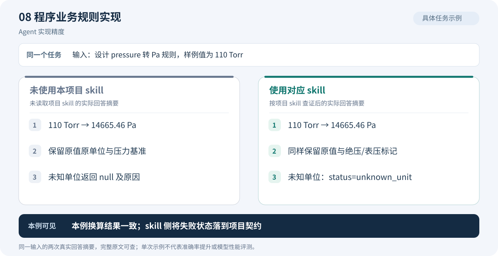
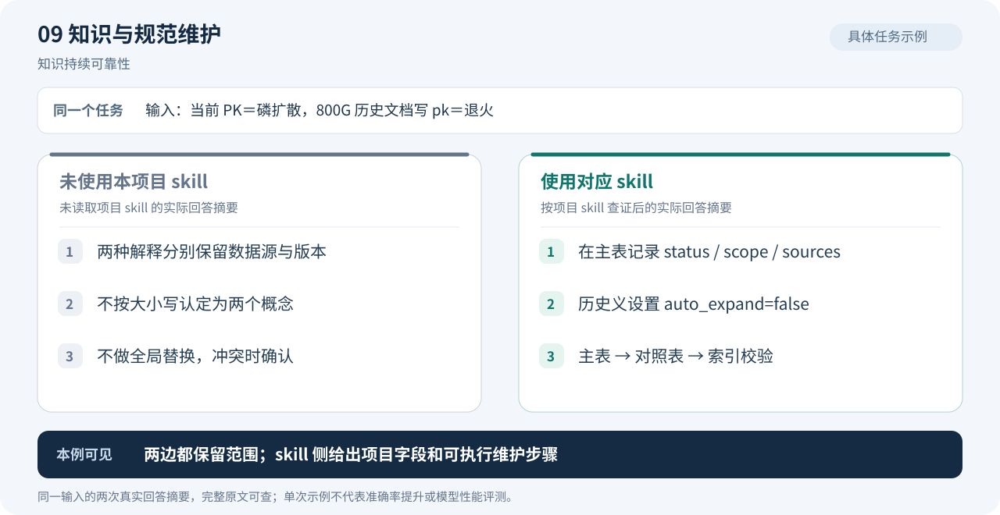

# 拉普老师傅：实际效果与完整案例

[返回项目首页](../../README.md) · [Lapdex 用户手册](../usage.md) · [源码维护参考](../maintenance.md)

本页保留已有知识与 Office 工具的实际案例，尚未作为 Lapdex 实机调用记录；当前发行版本与验证范围见[用户手册](../usage.md#version)。

每个功能一张图。知识类图示摘录了**相同输入下的两次真实回答**：一侧未读取本项目 skill 和业务资料，另一侧按对应 skill 查阅本地依据。Office 类图示使用**本次实际生成并处理的 Word、Excel、PPT 示例文件**，左侧是未规范化原稿，右侧是工具输出。

这些是单次案例，**不是严格的模型 A/B 性能评测，也没有准确率提升的统计结论**。未使用 skill 的回答也可能正确；以下保留两侧结论一致的情况。Office 模板仍为草案，专业内容判断与格式规范化分别检查。

| 改善方向 | 对应功能 | 具体看什么 |
|---|---|---|
| Agent 精度 | 专业知识、简称消歧、数据口径、程序业务规则、知识维护 | 含义是否匹配上下文，条件是否完整，判断是否有项目依据 |
| 文档规范性 | 文档编写、Office 样式、公司 Logo、批量处理与复核 | 术语与结论写法是否一致，样式是否符合所选模板，交付记录是否完整 |
| 琐碎工作自动化 | 模板应用、Logo 放置、批量处理与报告生成 | 哪些步骤已由工具完成，哪些仍需人工确认和复核 |

## 专业知识支持：从行业解释到项目依据

**实际问题：**“在光伏管式工艺中，用两句话区分 BK 与 PE，并说明依据和不确定项。”两侧都识别了硼扩和 PECVD；使用 skill 的回答进一步引用本项目用户命名约定及设备资料章节，明确仍需核对设备、膜层和工步。

[完整输入、原始回答与出处](agent-comparison.md#knowledge) · [kd-context](../../skills/kd-context/SKILL.md)

## 看懂行业黑话：从简称到上下文中的业务含义

**实际问题：**Longji OD 数据有 `TubeID/BoatID/ZoneID/P1–P5/Homogen/Quality`，OD 指什么，ZoneID 是温区吗？未读本地资料的回答保留多种可能；使用 skill 后，能根据资料说明 OD 是方阻检测数据，ZoneID 是检测位置，不能直接等同加热温区。

[完整输入、原始回答与出处](agent-comparison.md#names) · [名称消歧流程](../../source/workflows/name-disambiguation.md)

## 数据口径核对：明确哪些指标还不能计算

**实际输入：**同一炉管和批次在 `08:00/08:30` 的两条记录，`count` 从 0 增至 500，温度原值从 610 升至 615。两侧均未臆算 OEE；使用 skill 的回答进一步明确，记录间隔不等于整批周期，计数变化也不能直接当作良品产量。

[完整输入、原始回答与出处](agent-comparison.md#data) · [kd-data-analysis](../../skills/kd-data-analysis/SKILL.md)

## 文档编写：统一观察、结论边界与待确认事项

**实际任务：**为批次 B01 撰写报告开头，只有温度原值 1020/1030，没有单位和配方限。两侧都没有认定超温；使用 skill 的草稿把数据观察、因果边界和待核事项分别写清，并指出典型工艺温度不能当作本批次合格线。

[完整输入、原始回答与出处](agent-comparison.md#document) · [kd-document-writing](../../skills/kd-document-writing/SKILL.md)

## Office 模板与样式：查看真实 Word 前后变化

**实际文件：**`technical-note.docx`。原稿使用宋体 13 pt；工具按草案配置统一为微软雅黑，并设置标题 22 pt、正文 11 pt、页眉 Logo。下图直接嵌入原生 PDF 的页面截图，正文内容保真检查通过。

[原稿 PDF](office/before/technical-note.before.pdf) · [处理后 PDF](office/after/technical-note.review.pdf) · [处理后 Word](office/after/technical-note.docx)

## 公司 Logo：查看真实 PPT 的品牌呈现变化

**实际文件：**同一页 `equipment-overview.pptx`。处理前无 Logo，处理后在右下角按原比例放置公司 Logo，同时应用草案字体和标题样式，页面数量与原有文字保留。截图展示实际输出，不代表正式公司模板已获批准。

[原稿 PDF](office/before/equipment-overview.before.pdf) · [处理后 PDF](office/after/equipment-overview.review.pdf) · [处理后 PPT](office/after/equipment-overview.pptx)

## 批量处理与复核：从文件夹到逐文件交付记录

**实际执行：**对示例文件夹的 Word、Excel、PPT 共 3 份文件运行 `laplace-office-standardize`。报告记录 3 份文件均完成原生处理，`content_unchanged=true`；原始状态为 `processed_needs_visual_review`，不会将程序检查等同于视觉验收。本次另行渲染并查看了三份输出 PDF 的首页。

[本次真实处理报告](office/after/standardization-report.json) · [处理前文件夹](office/before) · [处理后文件夹](office/after)

Excel 也包含在这次处理内：[原稿 PDF](office/before/measurement-record.before.pdf) · [处理后 PDF](office/after/measurement-record.review.pdf) · [处理后 Excel](office/after/measurement-record.xlsx)。表头样式与打印页眉 Logo 已改变，数值、公式、数字格式及工作表结构保留。

## 程序业务规则：将正确计算衔接到项目契约

**实际任务：**设计 `pressure` 转 Pa 的输入输出规则，并计算 110 Torr。两侧都得到约 `14665.46 Pa`，都保留原值与压力基准；使用 skill 的回答进一步采用明确的 `status=unknown_unit` 等契约写法。

[完整输入、原始回答与出处](agent-comparison.md#software) · [kd-software-development](../../skills/kd-software-development/SKILL.md)

## 知识与规范维护：把范围约定落到主表和校验步骤

**实际任务：**当前 PK 表示磷扩散，800G 历史文档却将 pk 标为退火。两侧都保留局部解释而不全局替换；使用 skill 的回答进一步明确主表字段 `status/scope/sources`、历史义的 `auto_expand=false` 及对照表、索引的同步步骤。

[完整输入、原始回答与出处](agent-comparison.md#maintenance) · [kd-knowledge-maintenance](../../skills/kd-knowledge-maintenance/SKILL.md)

图中回答为摘要，完整原文保存在[实际回答示例](agent-comparison.md)；图中文字及素材引用维护在 [comparison-scenarios.json](../comparison-scenarios.json)，可在项目根目录运行 `python docs/tools/build_comparisons.py` 重新生成，`--check` 检查一致性。
