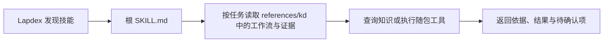

# 拉可老师傅适配 Lapdex 的设计与实施

本文面向需要维护或复用本次适配的开发者，说明怎样将已有 KD 工作区做成可分发的 Lapdex skill。安装操作见 [Lapdex 使用说明](lapdex.md)。

适用基线：Lapdex 官方发布包 `2026.6993.738.0`、本项目 `codex/lapdex-skill` 分支及插件 `0.1.0`。记录日期为 2026-11-02。下文区分已核对的加载器行为、本项目的设计选择和已完成的验证；升级 Lapdex 后应重新核对加载规则。

## 1. 适配目标与交付物

v0.1.0 适配了六类工作流、带出处的本地知识库和 Office 规范化工具。用户把一个 `laco-laoshifu/` 目录安装到 Lapdex 的技能目录，模型通过同一个入口按任务读取所需资料，再调用随包脚本。

本次采用 **用户目录中的自包含 skill 包**。它使用 Lapdex 的技能发现机制，无须修改 Lapdex 程序、建立 Connector、启动额外服务或编写原生扩展。

| 仓库中的文件 | 职责 |
|---|---|
| [integrations/lapdex/SKILL.md](../integrations/lapdex/SKILL.md) | Lapdex 入口模板：触发描述、资源定位、工作流选择和执行边界 |
| [scripts/package_lapdex.py](../scripts/package_lapdex.py) | 构建 ZIP、检查归档、预览安装和安装到指定技能目录 |
| [tests/test_package_lapdex.py](../tests/test_package_lapdex.py) | 验证搬迁、文件保真、覆盖保护及归档异常处理 |
| [dist/laco-laoshifu-lapdex-0.1.0.zip](../dist/laco-laoshifu-lapdex-0.1.0.zip) | 可直接解压安装的发行包 |
| [dist/laco-laoshifu-lapdex-0.1.0.zip.sha256](../dist/laco-laoshifu-lapdex-0.1.0.zip.sha256) | 整个 ZIP 的 SHA-256 |

`bundle-manifest.json` 是本项目生成的完整性清单；Lapdex 发现这个普通 skill 不依赖该清单。

## 2. 先确认 Lapdex 的加载约定

本次核对了官方安装包中的 authoring 文档和实际加载器源码。适配依据如下。

| 约定 | 核对结果及对本项目的影响 |
|---|---|
| 用户技能位置 | 默认支持 `~/.lapdex/skills/[category/]<name>/SKILL.md`；运行时还支持活动 profile 和外部技能目录 |
| 入口格式 | YAML frontmatter 包含 `name`、`description`，分隔符闭合，后面有非空正文 |
| 发现方式 | 递归查找 `SKILL.md`；在已有技能根中跳过 `references/`、`templates/`、`assets/`、`scripts/` 支持目录 |
| 描述长度 | 创建新技能时检查 60 字符上限；索引中的长描述会截断。已有技能编辑允许更长描述，不能据此放宽新入口 |
| 分类与标签 | 分类由目录层级提取；标签可使用 `metadata.lapdex.tags` |
| 元数据 | `version`、`author`、`license`、`platforms` 等属于官方仓库的推荐或审核规范，并非普通用户技能全部必填 |
| 刷新 | 核对版本的技能列表缓存约 30 秒；必要时重新打开应用，不能保证所有版本都相同 |

当前入口保持 UTF-8、无 BOM，并以 `---` 开始。实际校验器容忍 UTF-8 BOM；这里采用无 BOM 是本项目的输出约定。

官方 authoring 文档同时约束向 **Lapdex 官方源码仓库**贡献内置技能的结构、审核和文档生成。本次发布的是自有用户技能包，没有将这些上游贡献流程误作本项目的安装要求。

## 3. 一个可发现入口，业务资源整体放入 references

发行包的目录为：

```text
laco-laoshifu/
├─ SKILL.md
├─ bundle-manifest.json
└─ references/
   └─ kd/                         业务资源根
      ├─ AGENTS.md
      ├─ source/
      │  ├─ README.md
      │  ├─ glossary.json
      │  ├─ catalog.json
      │  ├─ manifest.json
      │  ├─ references/kd/        原始资料快照，保留原有名称
      │  ├─ knowledge/
      │  ├─ evidence/
      │  ├─ workflows/
      │  ├─ templates/
      │  └─ tools/kb.py
      └─ skills/
         ├─ kd-context/
         ├─ kd-data-analysis/
         ├─ kd-document-writing/
         ├─ kd-software-development/
         ├─ kd-knowledge-maintenance/
         └─ laplace-office-standardize/
```

Lapdex 发现外层 `SKILL.md` 后，扫描器跳过它旁边的 `references/` 子树。内部六个 `skills/*/SKILL.md` 因而作为按需读取的工作流资源，不再重复出现在技能列表中。模型仍可按入口中的链接读取这些文件。

外层 `references/` 用于 Lapdex 的资源组织；内部 `source/references/kd/` 是原项目的原始资料快照目录，两者职责不同。



如果把六个子技能直接放在入口旁边的 `skills/` 中，递归扫描会额外发现它们。构建器把供入口读取的业务资源统一放在 `references/kd/`。

## 4. 保留资源之间的路径关系

构建器采用下面的映射，复制文件内容时保持原始字节：

| 仓库路径 | 安装包内路径 |
|---|---|
| `integrations/lapdex/SKILL.md` | `SKILL.md` |
| `integrations/lapdex/AGENTS.md` | `references/kd/AGENTS.md` |
| `source/**` | `references/kd/source/**` |
| `skills/` 中由 `SKILL_NAMES` 列出的六个目录 | `references/kd/skills/` 下的对应目录 |

原子技能中的 `../../source/` 仍指向同一个业务资源根下的知识库；知识库指向 `../skills/` 的链接也继续有效。无需为打包而批量改写原文、词典或索引。

运行脚本依靠自身路径定位资源：

- `source/tools/kb.py` 的 `ROOT` 从 `Path(__file__).resolve()` 推导到 `source/`。
- `skills/laplace-office-standardize/scripts/office.py` 的 `SKILL` 从自身路径推导到 Office 技能目录。
- 入口要求模型先确定本技能的实际安装目录，再使用绝对脚本路径；当前对话的项目目录不参与资源定位。

因此可以将整个插件搬到另一台机器或含中文、空格的目录，再从无关工作目录执行查询。

`source/manifest.json` 中的旧机器路径属于出处记录，保留原样。资料中的历史解释器路径不作为运行依赖。包中不包含 `.git`、`.agents/skills` 目录联接、Python 字节码或本机凭据；仓库 `README.md` 和 `docs/` 也不进入技能包，避免引入不随包交付的文档依赖。

## 5. 编写 Lapdex 入口

当前入口的 frontmatter 如下：

```yaml
---
name: laco-laoshifu
description: 检索光伏工艺与行业简称，辅助数据、技术文档和程序工作，并规范化拉普拉斯 Office 文档.
metadata:
  package_version: "0.1.0"
  lapdex:
    tags: [photovoltaics, topcon, kd, laplace, knowledge, office, chinese]
---
```

`name` 使用稳定的小写连字符名称，并与顶层目录及打包脚本中的 `SKILL_NAME` 保持一致。短描述将主要业务能力放在 60 字符内，详细流程留在正文。

`metadata.package_version` 是本项目的版本记录，不能等同于 Lapdex 会将它显示为顶层 `version` 字段。发行包的版本还由构建器 `VERSION` 和包内清单记录。

正文包含三类信息：

1. **资源位置和任务选择。** 先用 `read_file` 读取业务资源根中的工作约定和知识库入口，再根据问题读取相关子工作流。
2. **实际执行方式。** 用 Lapdex 的 `terminal` 调用当前环境可用的 Python；用 `search_files` 定位材料。支持文件也可通过 `skill_view` 的相对文件路径读取。
3. **业务判断边界。** 简称按来源消歧，参数保留参考性质，OEE 保留统计口径；普通查询不更新知识库，Office 调整另存副本。

知识查询只依赖 Python 3.10+ 标准库。Office 原生规范化另需 Windows、PowerShell 和相应 Microsoft Office 应用；入口要求先运行 `doctor`。没有 Python 时仍可直接读取随包资料，但应说明哪些命令尚未执行。

## 6. 构建、校验与安装

以下命令在本仓库根目录执行，`python` 应指向 Python 3.10+。

### 6.1 生成发行包

仓库已经提供 `dist/` 发行文件，复核源码时可先构建到新目录：

```powershell
python scripts/package_lapdex.py --output build/lapdex-check
python scripts/package_lapdex.py --check build/lapdex-check/laco-laoshifu-lapdex-0.1.0.zip
```

不带 `--output` 时输出到 `dist/`。默认拒绝覆盖已有 ZIP 和校验文件；确需重建同版本发行文件时使用 `--force`。输出不能位于 `source/` 或 `skills/` 资源树内。

构建器收集入口及业务资源、验证必需文件和原始快照，再生成归档。临时归档通过校验后，才写入目标 ZIP 和外部 `.sha256` 文件。

### 6.2 理解两类清单

| 清单 | 检查对象 | 更新方式 |
|---|---|---|
| `references/kd/source/manifest.json` | 原始资料快照及其出处、大小和 SHA-256 | 仅按知识维护流程更新 |
| 根 `bundle-manifest.json` | 本次发行的 66 个载荷文件、版本、构建时 Git HEAD | 每次构建生成，不将清单自身列入载荷 |

包内清单检查是否遗漏、损坏或混入未列出的文件；外部 `.sha256` 用于核对整个 ZIP。它们都不提供发布者身份认证，也不能替代数字签名。

`source_commit` 记录构建时的 Git HEAD，不保证工作区没有未提交修改。正式发布时应先提交源码，再构建和提交发行文件。本次发行包记录源码提交 `73ed3d7`，ZIP 在后续提交 `256674a` 中加入仓库。

### 6.3 安装到用户技能目录

```powershell
python scripts/package_lapdex.py --check dist/laco-laoshifu-lapdex-0.1.0.zip
python scripts/package_lapdex.py --install dist/laco-laoshifu-lapdex-0.1.0.zip --dry-run
python scripts/package_lapdex.py --install dist/laco-laoshifu-lapdex-0.1.0.zip
```

安装器默认目标为运行用户的 `~/.lapdex/skills/laco-laoshifu/`。它不会自动读取 Lapdex 当前 profile 或外部技能目录配置；使用这些功能时，应显式传入对应的技能目录：

```powershell
python scripts/package_lapdex.py --install dist/laco-laoshifu-lapdex-0.1.0.zip --skills-dir "<user-selected Lapdex skills directory>"
```

归档校验会拒绝路径越界、重复项、大小写冲突、链接或特殊文件、未列入清单的载荷等异常。安装先写入同一父目录下的临时目录，再将完整技能目录移到目标位置；目标已存在时拒绝覆盖。

没有 Python 时，可用系统解压工具将 ZIP 内完整的 `laco-laoshifu/` 目录放入技能根目录。安装后应存在 `skills/laco-laoshifu/SKILL.md`，避免多套一层 ZIP 文件名目录。

### 6.4 发布与升级

发布新版本时，更新构建器 `VERSION`、入口 `metadata.package_version` 及说明文档中的版本引用。当前校验器要求包版本与脚本版本一致；校验旧发行包时使用对应版本脚本。

如果修改了知识正文，先按知识维护工作流更新派生对照表和索引、检查原文快照，再打包。用户安装副本可能已有自己的知识补充，升级前需备份并审阅差异；`--force` 只用于构建产物，不能强制覆盖已安装技能。

## 7. 验证适配是否成立

| 层次 | 检查内容 | 本次状态 |
|---|---|---|
| 文件和格式 | 入口 frontmatter、描述长度、包布局、归档校验 | 已通过 |
| 加载规则 | 用所核对版本的校验器和扫描函数检查，只发现外层 1 个技能 | 函数级检查通过，未启动完整应用 |
| 资源搬迁 | 隔离目录安装后，从无关目录执行知识库校验和查询 | 已通过，含中文与空格路径 |
| 工具行为 | 7 项打包/安装测试、27 项知识库测试；Office 依赖检查 | 已通过；Office 应用未启动 |
| 虚拟机传输 | 回读 `<transfer directory>` 中的 ZIP、校验文件和安装说明并比对 SHA-256 | 三个文件一致 |
| Lapdex 实际使用 | 界面发现、启用、模型选择、真实调用与输出 | 尚未完成 |

复制成功、哈希一致和扫描函数通过，各自验证不同条件，均不能作为已经完成 Lapdex 实机调试的证明。

维护者可执行仓库内的验证命令：

```powershell
python -B -m unittest discover -s tests -v
python -B -m unittest discover -s source/tests -v
python scripts/package_lapdex.py --check dist/laco-laoshifu-lapdex-0.1.0.zip
```

再将包安装到隔离目录，从其他工作目录用绝对路径运行随包 `kb.py` 的 `verify`、`index --check`、`crosswalk --check`、`abbr "硼扩散" --json`、`abbr OD --json` 和 `search "硼扩散 炉管" --limit 5`。原始快照应保持哈希，`OD` 应保留带来源范围的多个候选。

上游扫描器与 frontmatter 校验器的函数级试验使用的是本次只读提取的发布源码；这些源码及临时试验脚本未随本仓库分发。复现这部分验证时，需要取得相同版本的上游文件。

## 8. 常见问题与定位顺序

| 现象 | 优先检查 |
|---|---|
| 列表中找不到 `laco-laoshifu` | 活动 profile、实际技能目录、解压层级、根 `SKILL.md`、缓存刷新及启用状态 |
| 同时出现外层入口和多个 KD 子技能 | 是否把内部 `skills/` 放在外层可扫描位置；应保持在 `references/kd/skills/` |
| 查询找不到词典或脚本 | 是否只复制了入口、是否移动了内部目录、调用路径是否以实际安装位置为基准 |
| 提示 Python 不可用 | 检查解释器和版本；可先直接读取资料，不照搬旧机器的 Codex 缓存路径 |
| Office 处理失败 | 先运行 `doctor`，核对系统、Office、PowerShell、模板和 Logo；依赖可用后仍需实际输出复核 |
| 安装器提示目标已存在 | 保留用户知识补充，先备份和审阅差异，再准备干净目标目录 |
| 旧 ZIP 被新版脚本拒绝 | 当前脚本对清单版本严格匹配，使用对应发行版脚本校验 |

## 9. 规则依据与后续复核位置

上游来源为 [Lapdex 官方 AppInstaller](https://llm.laplace-tech.com:8087/lapdex-releases/releases/win32/stable/stable.appinstaller) 指向的 `LapdexBundled-2026.6993.738.0-win.msixbundle`。本次通过 HTTP Range 只读提取所需文件，没有安装或执行其中的应用程序。发布地址后续可能变化，以下定位以该版本为准。

| 上游文件与位置 | 用于核对的规则 |
|---|---|
| `lapdex-agent-skill-authoring/SKILL.md`，Overview、Required Frontmatter | 用户技能与官方仓库贡献方式的区别、入口结构 |
| `tools/skill_manager_tool.py`，108–114、146–179 行 | 名称长度、frontmatter 校验及新建技能描述限制 |
| `agent/skill_utils.py`，31、842–851 行 | 支持目录集合、递归发现与剪枝条件 |
| `tools/skills_tool.py`，38、130–141、193–207 行 | 缓存、目录分类及列表扫描 |
| `tools/skills_tool.py`，594–598、636–651 行 | 标签读取、实际技能目录及支持文件读取信息 |

本项目的实现依据是上述入口模板、构建器和测试文件。后续适配其他 Agent 时，应重新核对目标产品的技能发现、支持目录和工具接口，再决定是否复用同一布局。
